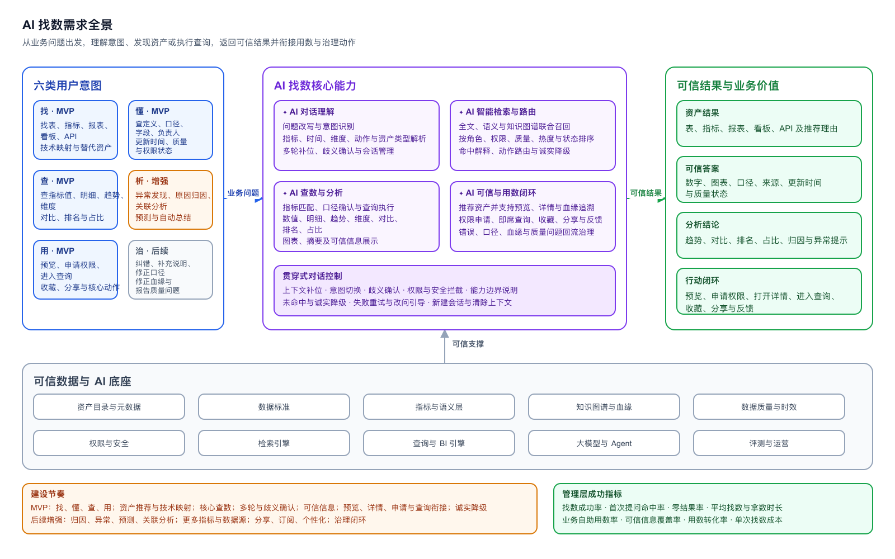

# 数据资产平台能力全景与 AI 找数需求

## 一、管理层摘要

数据资产平台以“接入、管理、发现、治理、使用、运营、服务化、底座”八项能力，形成从数据对象纳入、可信治理到业务消费与运营的完整闭环。当前蓝图既覆盖已有可演示或已上线能力，也明确 H2 建设重点和后续规划方向。

AI 找数是平台面向数据消费侧的智能入口：用户表达业务问题后，平台负责理解意图、查找合适资产或执行查询、返回带口径和来源的可信结果，并衔接预览、申请、查询、分享和治理动作。MVP 聚焦高频消费链路，优先验证找、懂、查、用的业务价值。

> 状态反映当前 PRD 和原型覆盖情况，不等同于生产环境可用性；正式对外或立项汇报前，产品和研发需共同校准“已具备”的生产可用口径。

## 二、状态与 AI 标记

| 标记 | 含义 |
| --- | --- |
| 已具备 | 当前 PRD 或原型已有明确产品能力，并已形成可演示或已上线链路 |
| 建设中 | 已进入 H2 规划、设计、开发或灰度范围 |
| 待规划 | 属于完整目标蓝图，但当前无明确交付计划或仅有方向性设想 |
| `✦ AI` | AI 直接参与该功能的理解、召回、推荐、生成、分析、诊断或评测 |

## 三、一级模块与二级功能

### 1. 资产接入

| 二级功能 | 状态 | 说明 |
| --- | --- | --- |
| 数据源管理 | 已具备 | 管理数据库、数仓及其他数据来源的连接信息和状态 |
| 元数据采集 | 建设中 | 采集库、表、字段、视图、报表等技术和业务元数据 |
| 自动扫描 | 建设中 | 按周期扫描新增、删除和变化的数据对象 |
| 资产注册 | 已具备 | 支持采集对象注册为平台资源，并进入后续维护和资产化流程 |
| 同步记录 | 建设中 | 展示采集时间、结果、变更数量、失败原因和重试状态 |
| 采集任务与变更发现 | 待规划 | 配置采集频率、范围和全量/增量策略，发现元数据变化 |
| 元数据智能补全与采集诊断 `✦ AI` | 待规划 | 补全描述、推荐标签，解释采集异常并给出处置建议 |

### 2. 资产管理

| 二级功能 | 状态 | 说明 |
| --- | --- | --- |
| 资产目录 | 已具备 | 按业务域和目录体系组织已上架资产 |
| 分类分级 | 已具备 | 管理业务分类、安全分类和等级 |
| 标签管理 | 已具备 | 维护标签、标签来源和资产关联关系 |
| 负责人管理 | 已具备 | 维护技术负责人、业务负责人及治理责任 |
| 生命周期与上下架 | 已具备 | 管理待维护、审批中、已上架、不上架等状态 |
| 版本管理 | 待规划 | 管理资产说明、结构、口径和服务版本 |
| 资产分组与专题 | 已具备 | 将相关资产组织为业务专题或资产集合 |
| 智能分类与标签推荐 `✦ AI` | 待规划 | 根据元数据、内容和使用行为推荐目录、分类和标签 |

### 3. 资产发现

| 二级功能 | 状态 | 说明 |
| --- | --- | --- |
| 全局搜索 | 已具备 | 按名称、别名、标签、负责人、来源、说明等检索资产 |
| 目录浏览 | 已具备 | 按业务目录和资产类型浏览资产 |
| 资源发现 | 已具备 | 同时发现已上架资产和未资产化资源 |
| 资产详情 | 已具备 | 查看元信息、字段、样例、分区、血缘、说明和变更记录 |
| 专题与最近浏览 | 已具备 | 展示热门专题、最近浏览、热门资产和收藏资产 |
| 语义检索与智能推荐 `✦ AI` | 建设中 | 理解业务表达，通过语义和图谱召回并解释推荐理由 |
| AI 找数 `✦ AI` | 建设中 | 用自然语言找资产、查指标、分析问题并进入后续用数动作 |

### 4. 数据治理

| 二级功能 | 状态 | 说明 |
| --- | --- | --- |
| 数据标准 | 建设中 | 管理业务术语、数据元、代码和指标口径 |
| 数据质量 | 待规划 | 管理质量规则、检核任务、质量评分和质量报告 |
| 数据血缘 | 已具备 | 查看表级和字段级上下游关系 |
| 影响分析 | 已具备 | 识别资产变化对上下游对象和字段的影响 |
| 敏感识别 `✦ AI` | 待规划 | 识别敏感字段和内容，推荐安全等级与保护策略 |
| 问题整改 | 待规划 | 将标准、质量、血缘和安全问题形成派单、整改、复核闭环 |
| 标准推荐与口径消歧 `✦ AI` | 待规划 | 推荐匹配标准，识别同名异义和异名同义问题 |
| 质量异常解释 `✦ AI` | 待规划 | 解释异常原因、影响范围和建议处置动作 |

### 5. 资产使用

| 二级功能 | 状态 | 说明 |
| --- | --- | --- |
| 权限申请 | 已具备 | 从资产详情或 AI 找数结果发起数据权限申请 |
| 审批 | 已具备 | 处理权限、上架、下架和治理类申请 |
| 订阅 | 待规划 | 订阅资产变化、质量变化和数据更新 |
| 收藏 | 已具备 | 收藏常用资产并在个人工作台查看 |
| 下载 | 待规划 | 在权限和安全策略允许时下载数据或文件 |
| API 调用 | 待规划 | 申请并调用资产对应的数据服务 |
| 使用指引 | 已具备 | 展示业务说明、字段说明、样例和使用注意事项 |
| 即席查询 | 已具备 | 对已有权限的数据表执行 SQL 查询 |
| 报表与看板预览 | 已具备 | 在平台内预览已接入的报表和看板 |

### 6. 资产运营

| 二级功能 | 状态 | 说明 |
| --- | --- | --- |
| 热度与使用次数 | 已具备 | 展示浏览、查询、收藏和申请等基础热度 |
| 用户评价 | 待规划 | 收集评分、问题反馈和使用体验 |
| 健康度 | 待规划 | 综合完整度、质量、时效、责任和使用情况评估健康状态 |
| 价值评估 | 待规划 | 综合使用量、业务覆盖和服务贡献评估资产价值 |
| 运营报表与 ROI | 建设中 | 展示资产使用趋势、找数成功率、自助用数率和治理成效 |
| 低活跃资产治理 | 待规划 | 识别长期未使用、低质量或重复资产并推动治理 |
| AI 运营摘要与治理建议 `✦ AI` | 待规划 | 自动总结运营变化、识别问题并给出治理建议 |

### 7. 资产服务化

| 二级功能 | 状态 | 说明 |
| --- | --- | --- |
| 数据产品 | 建设中 | 将数据集、报表、看板、API 等包装为可交付产品 |
| 指标服务 | 建设中 | 以统一口径对外提供指标查询与分析能力 |
| API 服务 | 待规划 | 配置、发布和授权数据 API |
| 数据市场 | 建设中 | 面向内部或外部用户展示可申请、试用或购买的数据产品 |
| 上下架管理 | 已具备 | 管理资产和数据产品的上架、下架及审批 |
| 服务授权与版本 | 待规划 | 管理服务调用权限、发布版本和回滚 |
| 调用统计 | 待规划 | 统计调用量、成功率、响应时间和调用方 |
| 交付与履约 | 待规划 | 管理申请、审批、开通、交付、确认和售后流程 |

### 8. 平台底座

| 二级功能 | 状态 | 说明 |
| --- | --- | --- |
| 组织用户 | 已具备 | 管理组织、部门和用户 |
| 角色权限 | 已具备 | 管理功能权限、数据权限和角色 |
| 审计日志 | 已具备 | 记录关键平台操作和治理动作 |
| 消息通知 | 已具备 | 通知申请、审批、变更和异常事项 |
| 系统与审批集成 | 建设中 | 对接飞书，并建设可扩展的审批适配能力 |
| 私有化部署 | 建设中 | 支持在客户环境部署和交付 |
| License 与模块授权 | 建设中 | 控制模块授权、使用期限和商业版本 |
| 开放 API 与 Webhook | 待规划 | 向外部系统开放资产、流程和事件能力 |
| 多租户与运维监控 | 待规划 | 支持多租户隔离、健康监控和运行告警 |
| AI 模型路由与评测 `✦ AI` | 待规划 | 管理模型选择、调用成本、效果评测和安全策略 |

## 四、AI 找数需求全景

### 1. 产品定位

AI 找数是资产平台面向数据消费侧的智能入口。用户只需要表达业务问题，平台负责理解意图、找到合适资产、返回可信答案，并衔接权限、预览、查询、分享和治理动作。

业务问题 → 理解用户意图 → 找到资产或执行查询 → 返回带口径和来源的结果 → 进入预览、申请、查询或治理动作。

### 2. 六类意图

AI 找数覆盖找、懂、查、析、用、治六类用户意图：

| 意图 | 范围 | 示例 | 建设节奏 |
| --- | --- | --- | --- |
| 找 | 找表、指标、报表、看板、API、技术映射和替代资产 | “用户留存应该看哪张报表？” | MVP |
| 懂 | 查定义、口径、字段、负责人、更新时间、质量和权限状态 | “GMV 的口径是什么？” | MVP |
| 查 | 查指标值、明细、趋势、维度、对比、排名和占比 | “昨天 GMV 按城市分布” | MVP |
| 析 | 异常发现、原因归因、关联分析、预测和自动总结 | “GMV 为什么涨了？” | 逐步增强 |
| 用 | 预览、申请权限、进入查询、下载、API、收藏、分享和订阅 | “帮我申请这张表的权限” | MVP 先打通核心动作 |
| 治 | 纠错、补充说明、修正口径与血缘、报告质量问题 | “这张表的负责人不对” | 后续闭环 |

### 3. 四个主要功能模块

#### A. 对话理解

- 自然语言输入与问题改写；用户意图识别。
- 解析指标、时间、维度、分析动作和资产类型槽位，支持多轮上下文补位。
- 识别歧义并提供候选确认，支持会话历史、新建会话和上下文清除。

#### B. 智能检索与路由

- 全文检索、语义检索和知识图谱联合召回。
- 在找资产、查数、分析、定义咨询、技术映射和用数动作间路由。
- 结合角色、权限、质量、热度和资产状态排序，展示命中原因与推荐理由。
- 对未命中、不支持或权限不足提供诚实说明与下一步引导；无法直接查数时降级推荐资产。

#### C. 查数与分析

- 进行指标识别、指标注册表匹配和口径确认。
- 支持数值、明细、趋势、维度拆解、对比、排名和占比查询；归因、异常和预测逐步扩展。
- 执行查询、生成图表和摘要结论，并展示口径、数据来源、统计时间和更新时间。

#### D. 可信与用数闭环

- 推荐表、指标、报表、看板和 API，支持报表与看板预览。
- 提供表详情、字段说明、样例、分区和血缘追溯。
- 支持权限申请、申请状态查看，以及携带表、字段和条件上下文进入即席查询。
- 支持收藏、分享、订阅和反馈，并将错误说明、口径、血缘和质量问题回流治理流程。

### 4. 可信底座

| 底座能力 | 对 AI 找数的作用 |
| --- | --- |
| 资产目录与元数据 | 提供资产名称、说明、标签、字段、负责人和状态 |
| 数据标准 | 统一业务术语、数据元和代码含义 |
| 指标与语义层 | 提供指标口径、维度、时间规则和可查询范围 |
| 知识图谱与血缘 | 提供资产关系、业务映射、来源和影响范围 |
| 数据质量与时效 | 帮助判断结果是否可信和是否过期 |
| 权限与安全 | 控制资产可见性、查询范围和脱敏策略 |
| 智能检索能力 | 支持从资产、标准和关系信息中精准发现相关内容，并按业务相关性提供推荐 |
| 数据查询与可视化能力 | 支持获取指标和明细结果，并以图表和摘要帮助用户理解业务情况 |
| AI 编排与效果运营能力 | 支持理解问题、协调找数与分析任务、组织可信结果，并持续评估成功率、准确性、成本、时效和用户反馈 |

异常和边界：无匹配资产时引导补充业务域、时间、指标或资产类型；指标有歧义时展示候选指标、口径摘要和可查性；指标未接入时推荐相关资产；权限不足时不泄露受限信息并提供申请入口；质量或时效不足时标记风险；查询失败时保留问题和解析条件并支持重试或转即席查询；能力未覆盖时明确说明不支持，不生成不可验证的答案。

### 5. MVP 与后续增强

**MVP**：找、懂、查、用四类核心意图；资产推荐与技术对象映射；指标值、趋势、维度、对比、排名和占比；多轮上下文和歧义确认；口径、来源和更新时间；报表/看板预览、表详情、权限申请和即席查询衔接；以及未命中、不支持和无法直接查数时的诚实降级。

**后续增强**：归因和异常解释、预测与关联分析、更多指标/维度/数据源、会话分享/订阅/主动推送、个性化推荐和反馈学习，以及纠错、口径、血缘和质量问题治理闭环。

### 6. 管理指标

| 指标 | 含义 |
| --- | --- |
| 找数成功率 | 用户问题最终获得可用资产或可信答案的比例 |
| 首次提问命中率 | 无需反复改问即可得到正确结果的比例 |
| 零结果率 | 无资产、无指标或无法回答的问题比例 |
| 平均找数与拿数时长 | 从首次提问到获得可用结果的时间 |
| 业务自助用数率 | 无需数据人员介入即可完成的用数比例 |
| 可信信息覆盖率 | 查数结果中同时展示口径、来源和时间信息的比例 |
| 用数转化率 | 结果进入预览、权限申请、查询、收藏或分享的比例 |
| 单次找数成本 | 模型、检索和查询资源的综合调用成本 |

## 五、图表文件

- 可编辑源图：[AI 找数需求全景.drawio](./2026-07-23-AI找数-需求全景.drawio)
- SVG 预览：[AI 找数需求全景.svg](./2026-07-23-AI找数-需求全景.svg)
- PNG 预览：[AI 找数需求全景.png](./2026-07-23-AI找数-需求全景.png)

